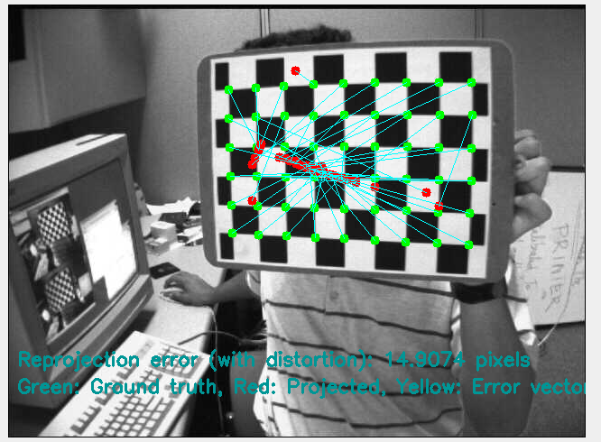
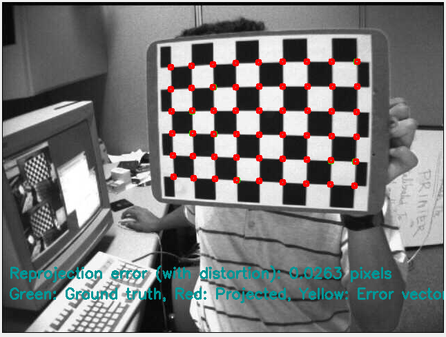

# Chessboard calibration with OpenCV and Python 

## Wrong order of object and image points.

When performing camera calibration with a chessboard and OpenCV, it is critical to ensure that the object points match the image points generated by the `cv2.findChessboardCorners` function. A mismatch in the order can lead to a degenerate solution of the calibration.

``` python
## Calibration function
ret, mtx, dist, rvecs, tvecs = cv2.calibrateCamera(obj_points, imgpoints, gray.shape[::-1], None, None)
```

The order of the detected corners in the image depends on the parameter `pattern_size`.
```
                          (inner conners per row, inner conners per column)                
                                                      ▲                                      
                                                      │                                      
  ret, corners = cv2.findChessboardCorners(gray, pattern_size, None)                         
```

Object points need to be created with this same `pattern_size`.

```python
@dataclass
class OpenCVChessboard:
    corners_per_row: int
    corners_per_column: int
    square_size: float

    def __post_init__(self):
        self.partern_size = (self.corners_per_row, self.corners_per_column)

    def create_chessboard_points(self) -> np.ndarray:
        objp = np.zeros((self.corners_per_row * self.corners_per_column, 3), np.float32)

        # RIGHT ORDER
        objp[:,:2] = np.mgrid[0:self.corners_per_row, 0:self.corners_per_column].T.reshape(-1,2) # RIGHT

        # WRONG ORDER
        # objp[:,:2] = np.mgrid[0:self.corners_per_column, 0:self.corners_per_row].T.reshape(-1,2) # WRONG
        return objp

```

On the left, calibration results when creating the wrong object points. On the right, calibration results when creating the correct object points.

<div style="display: flex; gap: 10px;">
  
  
</div>

