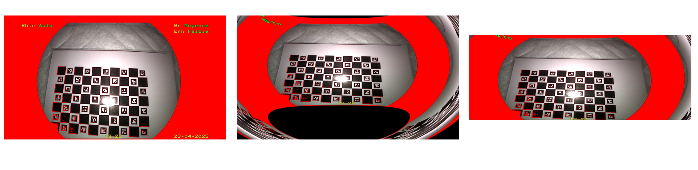

## Thoughts about Opencv undistortion notes

Why does the opencv undistortion function sends some pixels in the center to the border of the image? See [Figure 1](#fig:aggressive_distortion_model).

These initial results are generated with a 3 coefficient radial distortion model and 2 coefficient tangential distortion model. It seems the problem comes from the `K_3` coefficient which goes with the 6th order polynomial. Fixing this parameter to 0 in opencv helps obtain better results (see [Figure 2](#fig:conservative_distortion_model)).  

Notice how the scaling parameter in opencv could hide the error in the undistortion process (last image in both figures). The scaling parameter (see `alpha` parameter in [cv2.getOptimalNewCameraMatrix documentation][1]) crops the image to only include the valid pixels. Big changes in the resolution of the image after undistortion, could be an indication that the estimated distortion model is not appropriate for the camera. 

<figure style="width: 100%; margin: 0;">
    <a id="fig:aggressive_distortion_model">
     
    <figcaption>Figure 1: Aggressive distortion model. From left to right: the original image; the undistorted image with the scaling parameter set to 0 (all pixels included); and the undistorted image with the scaling parameter set to 1 (only valid pixels included).</figcaption>
</figure>
 

<figure style="width: 100%; margin: 0;">
    <a id="fig:conservative_distortion_model">
     
    <figcaption>Figure 2: Conservative distortion model. From left to right: the original image; the undistorted image with the scaling parameter set to 0 (all pixels included); and the undistorted image with the scaling parameter set to 1 (only valid pixels included).</figcaption>
</figure>

<!-- References: -->

[1]: https://docs.opencv.org/4.x/d9/d0c/group__calib3d.html#ga7a6c4e032c97f03ba747966e6ad862b1 "OpenCV getOptimalNewCameraMatrix documentation"